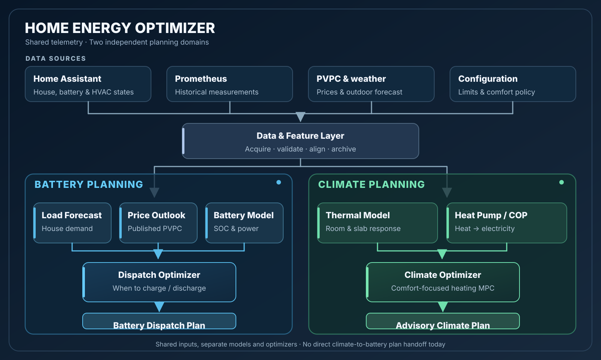

# battery-optimizer

[](https://github.com/pando85/home-energy-optimizer/actions/workflows/ci.yml)
[](https://github.com/pando85/home-energy-optimizer/actions/workflows/images.yml)
[](LICENSE.md)


Home energy optimization for Home Assistant, combining a PVPC-aware battery dispatch
optimizer with a climate comfort optimizer. Both share the Home Assistant / Prometheus
data foundation and the reproducible offline extraction, dataset and benchmark pipeline
([ADR-0003](docs/adr/0003-phase1-measurement-and-baseline.md)). The resident service
computes battery plans and can optionally evaluate the climate MPC on live data; battery
actuation is separately gated ([service operations](docs/service.md) and
[ADR-0007](docs/adr/0007-live-battery-control.md)).

## Architecture

<div align="center">
  
</div>

**Two planners, one data foundation.** The battery path optimizes charging and discharging
using demand forecasts, published electricity prices and battery constraints. The climate
path uses thermal and heat-pump models to optimize heating around comfort. They share
telemetry and feature preparation, but have **no direct planner-to-planner handoff today**;
the implemented climate MPC is price-blind.

The named components are **logical modules of one Python application**, not separate
services. Details: [battery planning components](docs/architecture.md#planning-components),
[climate models and MPC](docs/architecture.md#climate-subpackage-climate),
[component dependencies](docs/components/README.md#dependency-map) and
[resident service](docs/service.md).

## Quick start

Requires Python 3.14 and [uv](https://docs.astral.sh/uv/); the development recipes also need [just](https://just.systems).

```bash
# Run from a checkout
uv sync --extra dev
uv run battery-optimizer --help

# Or install the CLI from a release
uv tool install https://github.com/pando85/home-energy-optimizer/releases/download/vX.Y.Z/battery_optimizer-X.Y.Z-py3-none-any.whl
```

Or run the multi-arch container image (`ghcr.io/pando85/battery-optimizer`; tags, the `serve` example and
provenance verification are in [docs/container.md](docs/container.md)):

```bash
docker run --rm ghcr.io/pando85/battery-optimizer:latest --help

# Mount the private data directory and the tariff config; pass secrets by name, never by value.
docker run --rm --read-only \
  -v "$HOME/data/energy-baseline:/data" \
  -v "$PWD/config:/config:ro" \
  -e BATTERY_OPTIMIZER_DATA_DIR=/data \
  -e BATTERY_OPTIMIZER_CONFIG=/config/tariff.yaml \
  -e BATTERY_OPTIMIZER_HA_TOKEN \
  ghcr.io/pando85/battery-optimizer:latest validate
```

The minimal environment:

- `BATTERY_OPTIMIZER_DATA_DIR`: private dataset store, **outside** any git worktree (default `~/data/energy-baseline`).
- `BATTERY_OPTIMIZER_CONFIG`: tariff configuration file (default `config/tariff.yaml`).
- `BATTERY_OPTIMIZER_HA_TOKEN`: non-admin Home Assistant token, needed for HA extraction, `ha-states` and `serve`
  (used read-only except by `serve` in `mode: live`).

The full table, the data directory rules and the secrets policy are in
[docs/configuration.md](docs/configuration.md).

## Usage

| Command | Purpose |
|---|---|
| `extract` | Ingest from Prometheus / HA history to Parquet |
| `validate` | Validate raw Parquet against schemas and manifest hashes |
| `build` | Build the 15-min analysis dataset |
| `benchmark` | Run the policy ladder (no battery to oracle) on a dataset |
| `report` | Generate the monthly reconciliation report |
| `inspect-sql` | Inspect DuckDB SQL queries |
| `ha-states` | Read Home Assistant enum state history (deduplicated, as-of) |
| `serve` | Resident shadow service: read-only HA/Prometheus, live MPC, intents recorded never sent |
| `shadow-report` | Shadow plans vs native battery behaviour: coverage, energy, cost, SOC violations |
| `mirror` | Deferred, not implemented in Phase 1 |

Flags, exit codes and examples: [docs/cli.md](docs/cli.md) and [docs/benchmark.md](docs/benchmark.md).

## Development

```bash
just              # list the recipes (https://just.systems)
just git-hooks    # install the pre-commit and commit-msg hooks (once)
just lint         # all pre-commit checks: ruff, yamllint, shellcheck, uv.lock, ...
just fmt          # ruff check --fix and ruff format
just test         # pytest
just image        # build the container image locally
```

Commits follow [Conventional Commits](https://www.conventionalcommits.org/), are signed and carry
`Signed-off-by` (`git commit -s`). Releases are cut with `just release`; see
[`.opencode/skills/release/SKILL.md`](.opencode/skills/release/SKILL.md).

## Documentation

- [Configuration](docs/configuration.md): environment variables, data directory, Home Assistant authentication, secrets policy
- [CLI reference](docs/cli.md) and [benchmark reference](docs/benchmark.md)
- [Architecture](docs/architecture.md) and the [shadow service](docs/service.md)
- [Climate implementation plan](docs/planning/climate-optimizer-implementation.md) (**C2 thermal models UNDETERMINED/no-go**, not authorized for active planning), [diagnostic-first C2 recovery roadmap](docs/planning/climate-c2-recovery.md), [optional flow-temperature calibration extension (C7-F)](docs/planning/climate-flow-calibration-optimization.md), and [ADR-0005](docs/adr/0005-shared-energy-planning-climate.md) (no climate or battery actuation change)
- [Container image](docs/container.md)
- [Known issues](docs/known-issues.md)
- [ADRs](docs/adr/), [planning notes](docs/planning/) and [provenance](docs/provenance.md)

The full index is [docs/README.md](docs/README.md).

## Security

See [SECURITY.md](SECURITY.md) for how to report a vulnerability.

## License

GPL-3.0, see [LICENSE.md](LICENSE.md).
